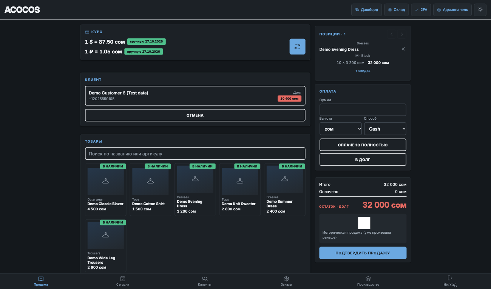
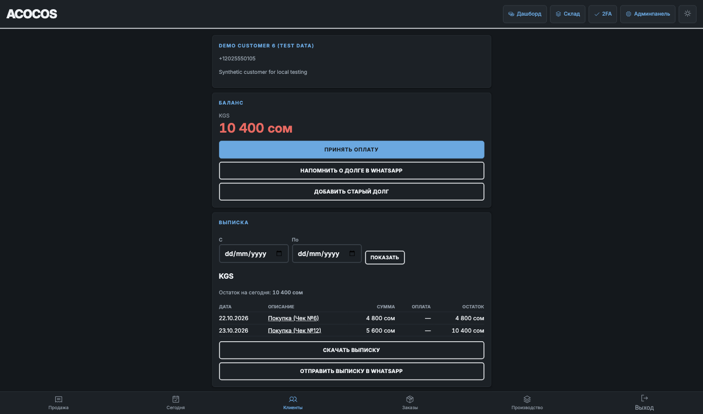
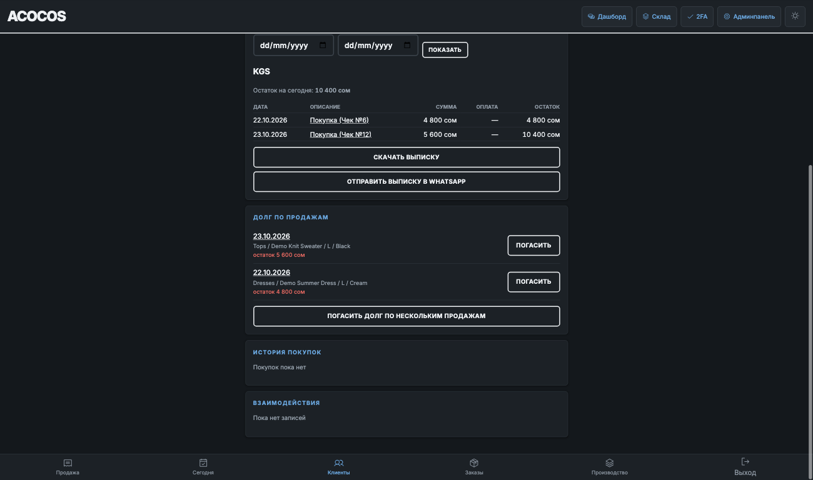
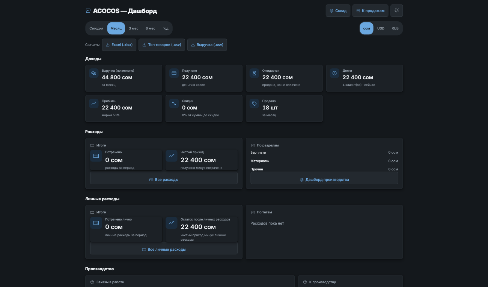
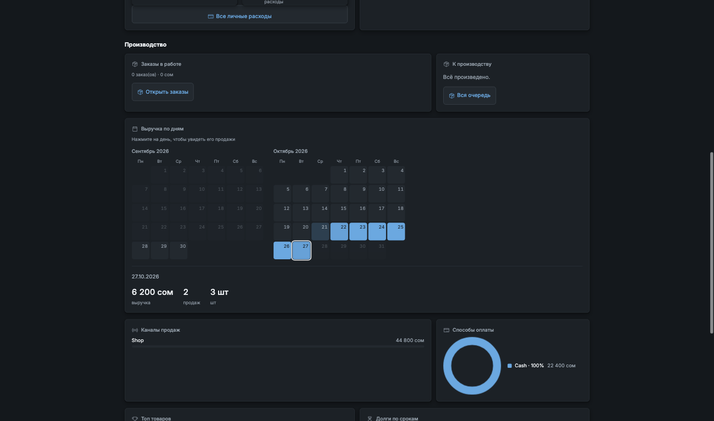
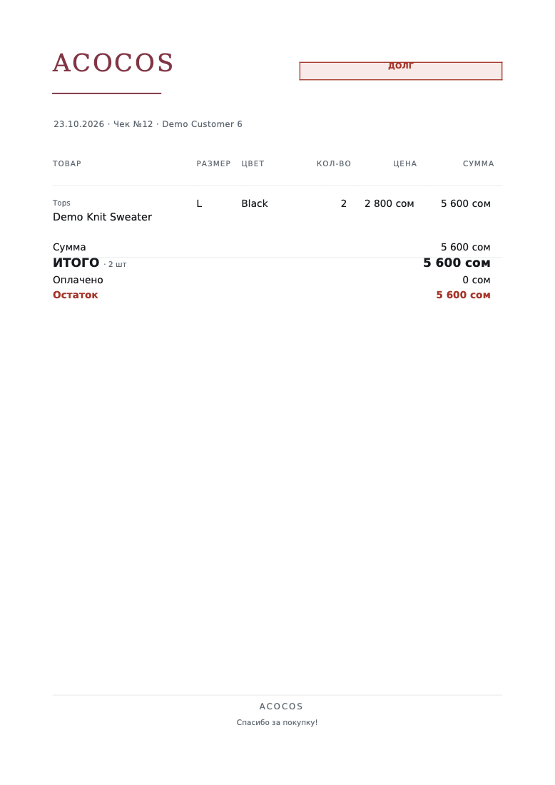

# ACOCOS: CRM and POS for a clothing manufacturer

Case study. The source code is private client work, so this repo documents what I built and how I built it. I'm happy to give a live demo on request.

## The problem

A small women's clothing manufacturer in Kyrgyzstan, with 2 to 4 staff, sells through Instagram, WhatsApp and a physical shop. It takes payment in three currencies: KGS, RUB and USD. Client balances were kept as handwritten statements. The business needed one system covering sales, stock, client debt and production.

## What I built

I am the sole developer. I designed, built, deployed and maintain the system, and it runs in production.

- **POS terminal**: mobile-first, with a photo grid for picking products and a sticky cart whose confirm button is always visible. Payments can be split across currencies, with change calculation and warnings when currencies are mixed.
- **Client accounts**: running-balance statements that match the owner's existing handwritten format, plus opening balances for debt that existed before the system.
- **Manufacturing**: contractors, production runs, defect tracking, and real cost compared against assumed cost.
- **Orders**: client orders linked to production runs, kept as a separate concept.
- **Expenses**: split into cost of goods and overhead.
- **Owner dashboard**: sales and profit analytics.
- **PDF receipts**: grouped by product, size and color, with unit totals for wholesale clients.
- **Bots**: a Telegram bot for staff, a Telegram bot for clients, and a WhatsApp Cloud API webhook.
- **Roles**: Owner, Manager and Viewer. Only the Owner can see cost prices and profit.

## Stack

Django 5, PostgreSQL, Redis, HTMX, Jazzmin admin, xhtml2pdf, Docker Compose, Gunicorn and Caddy, hosted on DigitalOcean (Frankfurt region). The interface is in Russian.

## Key design decisions

- **Server-rendered templates with HTMX, no JavaScript framework.** There is no npm and no build step, which keeps one server simple to run for a small business.
- **Stock is never stored as a number.** It is always computed from append-only stock movement records.
- **Client debt is never stored.** It is always derived from confirmed sales minus payments.
- **Money uses Decimal everywhere, never floats.** Each payment saves the exchange rate in effect when it was confirmed, so old payments are never re-converted at a new rate.
- **Business logic lives in a service layer**, not in views or templates.
- **Database constraints enforce the money and stock rules** as a second line of defense.
- **No Celery.** Scheduled jobs run as Django management commands from cron, which means fewer moving parts.
- **xhtml2pdf instead of WeasyPrint** for PDFs, to avoid system library dependencies in the container.

## Security

- Two-factor authentication for staff accounts
- Login lockout based on the client IP set by the reverse proxy, which the client can't spoof
- Argon2 password hashing, with older hashes upgraded automatically at login
- A strict Content Security Policy
- Rate limiting that fails closed: if Redis goes down, requests are blocked rather than let through
- No-store cache headers on logout, so a logged-out session can't be reopened with the back button
- Encrypted offsite backups using an rclone crypt remote
- A full security audit of the production system, followed by an ongoing phased remediation plan

## How I built it with AI

Claude Code was my main development tool throughout the project.

- A CLAUDE.md file records the project's hard rules (no Celery, no npm, logic in the service layer, and so on), so every agent session follows the same architecture.
- I have the agent analyze the code and propose a plan before it changes anything. Work ships in phases, and I review each phase.
- Every bug fix comes with a regression test.
- I used AI to audit the live system for security issues and to turn the findings into a phased fix plan.
- Before picking a visual direction for the POS and the receipts, I prototyped three directions as HTML mockups.

## Screenshots

Desktop captures from the local test instance (1300 × 768). All business and customer data shown is synthetic demo data.

### 01 · Point of sale

### 02 · Client accounts

**Balance and running statement**

**Purchase history and outstanding debt**

### 03 · Owner dashboard

### 04 · PDF receipt

